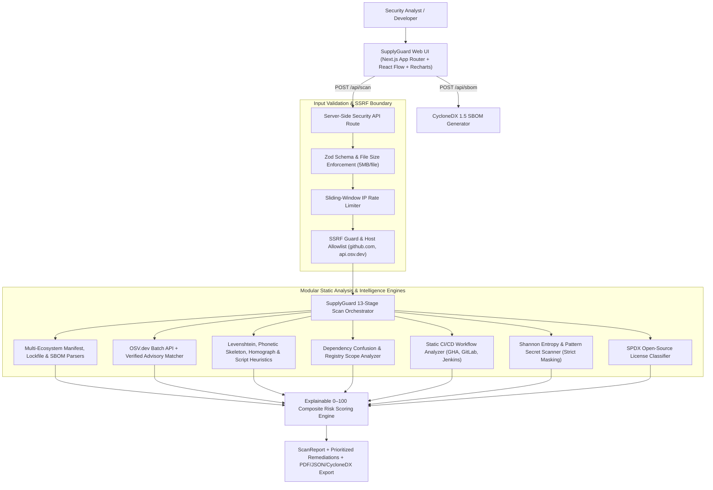

# SupplyGuard — Software Supply Chain Security & Intelligence Platform

> **Secure every dependency. Trust every build.**

SupplyGuard is a full-stack Software Composition Analysis (SCA) and Software Supply Chain Security platform engineered with **Next.js (App Router)**, **TypeScript (Strict Mode)**, **Tailwind CSS**, **React Flow**, and **Recharts**. It enables developers, DevSecOps engineers, and application security analysts to inspect direct and transitive dependency graphs, query live **OSV.dev** vulnerability intelligence, detect typosquatting and dependency confusion indicators, audit CI/CD workflow files statically, identify and mask accidentally committed secrets, classify open-source licenses, and export **PDF**, **JSON**, and **CycloneDX v1.5 SBOM** reports.

---

## 1. Architecture Overview



---

## 2. Core Features & Implementation Status

| Capability | Status | Implementation Details |
| :--- | :--- | :--- |
| **Multi-Ecosystem Dependency Parsing** | **Fully Implemented** | Parses `package.json`, `package-lock.json` (v1/v2/v3), `npm-shrinkwrap.json`, `yarn.lock`, `pnpm-lock.yaml`, `requirements.txt`, `poetry.lock`, `Pipfile.lock`, `Gemfile.lock`, `pom.xml`, `.npmrc`, and `pip.conf`. Prioritizes deterministic lockfile versions over loose manifest ranges. |
| **SBOM Ingestion & Export** | **Fully Implemented** | Parses uploaded **CycloneDX** (`bom.json`, `.cdx.json`) and **SPDX** (`.spdx.json`) documents and exports standards-compliant **CycloneDX v1.5 SBOM + VDR** JSON. |
| **Vulnerability Intelligence** | **Fully Implemented** | Queries **OSV.dev** (`https://api.osv.dev/v1/querybatch` & `/v1/vulns/{id}`) supplemented by a deterministic verified advisory engine with real CVE/GHSA identifiers, CVSS v3 scores/vectors, fixed versions, and dependency lineage paths. |
| **Malicious Package & Typosquatting Detection** | **Fully Implemented** | Computes Damerau-Levenshtein edit distance, phonetic/homoglyph skeleton normalization, Unicode homograph detection, version epoch anomalies, and `preinstall`/`postinstall` shell/network telemetry with an evidence-backed Suspicion Score (`0–100`). |
| **Dependency Confusion Analysis** | **Fully Implemented** | Detects unscoped internal package naming patterns, custom enterprise namespace prefixes, unmapped `@scope` registries in `.npmrc`, and insecure `--extra-index-url` directives in `pip.conf` and `requirements.txt`. |
| **Interactive Dependency Graph** | **Fully Implemented** | Built with `@xyflow/react` (React Flow) featuring root, direct, and transitive lineage layout, zoom/pan, mini-map, severity filtering, animated vulnerable path highlighting, and a node detail inspector. |
| **CI/CD Workflow Security Analysis** | **Fully Implemented** | Static analyzer for GitHub Actions (`.github/workflows/*.yml`), GitLab CI (`.gitlab-ci.yml`), and `Jenkinsfile` detecting unpinned third-party actions, `pull_request_target` hazards, `write-all` token permissions, untrusted `${{ github.event.* }}` command injection, and `curl \| bash` execution. |
| **Static Secret Detection & Redaction** | **Fully Implemented** | Combines prefix/structure regexes with Shannon entropy calculation (`bits/char`) to detect AWS keys, GitHub PATs, Stripe live keys, Slack tokens, private keys, JWTs, and database URIs. Strictly masks all values upon detection. |
| **License Compliance Matrix** | **Fully Implemented** | Identifies permissive (`MIT`, `Apache-2.0`, `BSD-2/3-Clause`, `ISC`), weak copyleft (`LGPL`, `MPL-2.0`), strong/network copyleft (`GPL-2.0/3.0`, `AGPL-3.0`), and unknown licenses with explicit legal disclaimers. |
| **Transparent Risk Scoring Engine** | **Fully Implemented** | Computes a deduplicated, normalized `0–100` risk score across 5 weighted domains with interactive weight customization in Settings. |
| **Multi-Format Security Reporting** | **Fully Implemented** | Client-side multi-table **PDF Security Assessment Report**, structured **JSON Assessment**, and **CycloneDX 1.5 SBOM** export. |
| **Persistent Cloud Database** | **Documented Demo / Stateless Mode** | Operates in stateless server-side scan + in-memory session workspace mode with 3 seeded, live-computed benchmark fixtures (`isDemoData: true`) clearly distinguished from live scans. |

---

## 3. Technology Stack

- **Frontend:** Next.js 16 (App Router), React 19, TypeScript 5 (Strict Mode), Tailwind CSS, Lucide Icons, `@xyflow/react` (React Flow), Recharts.
- **Backend:** Next.js Server Route Handlers (`/api/scan`, `/api/sbom`), Zod validation, `semver`, `yaml`, `fast-xml-parser`.
- **Reporting:** `jspdf`, `jspdf-autotable`, CycloneDX v1.5 serializer.
- **Testing:** Vitest unit & integration test suite (`src/__tests__/supplyguard.test.ts`).

---

## 4. Supported Ecosystems & File Formats

| Ecosystem | Manifests | Lockfiles (Prioritized) | Registry / CI Configs |
| :--- | :--- | :--- | :--- |
| **npm / Node.js** | `package.json` | `package-lock.json`, `npm-shrinkwrap.json`, `yarn.lock`, `pnpm-lock.yaml` | `.npmrc` |
| **Python / PyPI** | `requirements.txt` | `poetry.lock`, `Pipfile.lock` | `pip.conf` |
| **Ruby / RubyGems** | `Gemfile` | `Gemfile.lock` | — |
| **Java / Maven** | `pom.xml` | — | — |
| **SBOMs** | CycloneDX (`.cdx.json`, `bom.json`), SPDX (`.spdx.json`) | — | — |
| **CI/CD & Secrets** | — | — | `.github/workflows/*.yml`, `.gitlab-ci.yml`, `Jenkinsfile`, `.env*`, config files |

---

## 5. Scanning & Risk Scoring Methodology

### Deduplicated Composite Risk Score (0–100)
1. **Alias Deduplication:** Advisories sharing overlapping `CVE-*` and `GHSA-*` identifiers on the same package are merged prior to scoring so a single vulnerability is never double-counted.
2. **Reachability & Exploitability Multipliers:**
   - Base severity points: `CRITICAL = 28`, `HIGH = 16`, `MEDIUM = 8`, `LOW = 3`.
   - Scope multiplier: `1.25x` for direct dependencies, `0.85x` for transitive dependencies.
   - Exploitability multiplier: `1.35x` for known exploited advisories, `1.15x` for high-probability vectors.
   - Unpatched penalty: `1.15x` when no upstream patched version exists.
3. **Domain Normalization:** Each domain's raw points are mapped through a saturating exponential curve $S_d = 100 \times (1 - e^{-\text{raw} / \text{scale}})$ into $[0, 100]$.
4. **Default Domain Weights (Configurable in UI):**
   - Vulnerability Intelligence: **40%**
   - Malicious Package & Typosquatting Indicators: **20%**
   - Exposed Secrets: **15%**
   - CI/CD Pipeline Security: **15%**
   - Dependency Confusion & Restrictive Licenses: **10%**

---

## 6. Security Engineering & Limitations

- **No Execution of Untrusted Code:** SupplyGuard never runs `npm install`, `pip install`, lifecycle hooks, or CI/CD workflows on scanned targets. All analysis is static.
- **SSRF & Redirect Protection:** Remote repository scanning validates HTTPS URLs strictly against `github.com`, blocks private/loopback/link-local IPv4/IPv6 ranges (`127.0.0.0/8`, `10.0.0.0/8`, `169.254.169.254`, `192.168.0.0/16`, `::1`), and uses `redirect: "error"` on outbound API fetches.
- **Strict Secret Redaction:** Detected secrets are immediately masked (`maskSecretValue`), never logged in plaintext, and never sent to third-party APIs.
- **Known Limitations:**
  - Heuristic typosquatting indicators highlight statistical and structural anomalies (edit distance, homographs, install hooks) for human review and are not standalone proof of malicious intent.
  - Unauthenticated GitHub API requests are subject to GitHub's public rate limit (SupplyGuard automatically falls back to direct `raw.githubusercontent.com` manifest fetching when rate-limited, or supports an optional `GITHUB_TOKEN` environment variable).
  - License classifications are an engineering reference, not legal advice.

---

## 7. Local Development, Testing & Deployment

### Prerequisites
- Node.js `>= 20.x`
- npm `>= 10.x`

### Installation & Local Server
```bash
npm install --legacy-peer-deps
npm run dev
```
Open `http://localhost:3000` in your browser.

### Environment Variables (Optional)
Create a `.env.local` file if you wish to increase GitHub API rate limits for large repository tree discovery:
```env
# Optional: Personal Access Token (public_repo read-only) for higher GitHub API rate limits
GITHUB_TOKEN=
```
No environment variables are required for core scanning, OSV.dev queries, file uploads, or demo benchmarks.

### Running Automated Tests, Typecheck & Production Build
```bash
npm run typecheck
npm test
npm run build
```

---

## 8. API Documentation

### `POST /api/scan`
Executes a full 13-stage supply chain security scan.
- **Request Body (`mode: "github"`):**
  ```json
  {
    "mode": "github",
    "repositoryUrl": "https://github.com/expressjs/express",
    "internalPrefixes": ["@corp/", "internal-"]
  }
  ```
- **Request Body (`mode: "upload"`):**
  ```json
  {
    "mode": "upload",
    "projectName": "my-service",
    "files": [
      { "name": "package-lock.json", "content": "{ ... }" }
    ]
  }
  ```
- **Response:** `200 OK` with `{ "ok": true, "report": ScanReport }`.

### `POST /api/sbom`
Generates a CycloneDX v1.5 SBOM + VDR JSON document from a `ScanReport`.
- **Response:** `200 OK` with `{ "ok": true, "sbom": CycloneDxSbomDocument }`.
